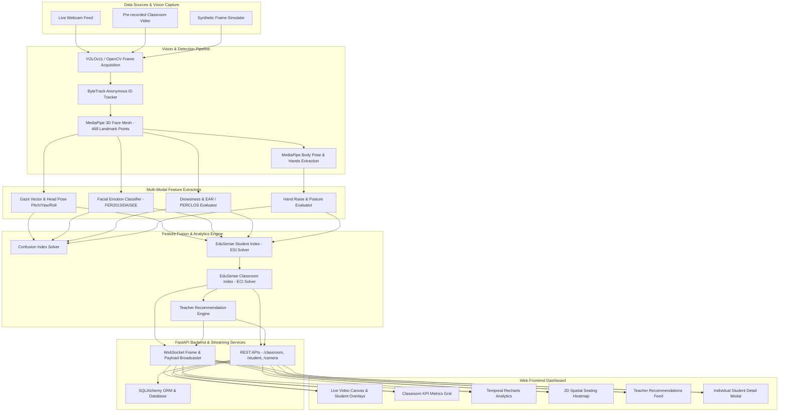

# EduSense System Architecture & Data Flow Specification

## Overview
EduSense employs a decoupled, multi-tier micro-service architecture separating real-time vision processing, multi-modal feature fusion, backend API streaming, and reactive frontend visualization.

## System Architecture Diagram (Mermaid)

