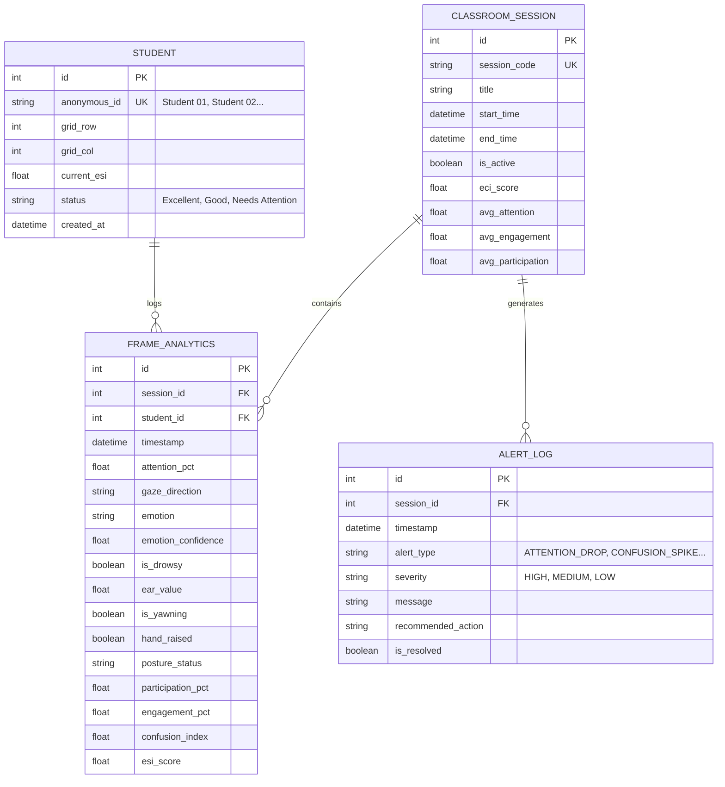

# EduSense Entity-Relationship (ER) Diagram Specification

## Overview
The EduSense database schema is designed for time-series classroom analytics logging and anonymous student session management.

## Mermaid ER Diagram

